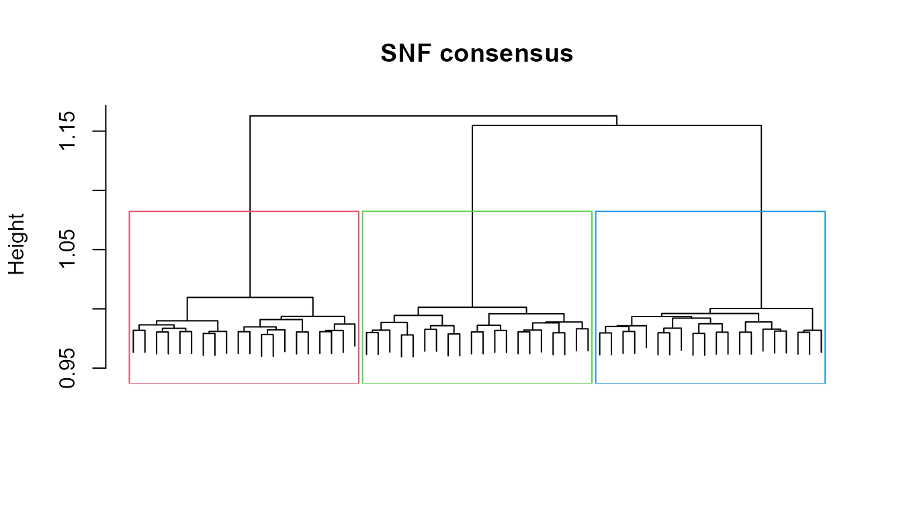

# MosaiClusteR: an umbrella framework for multi-source and multi-omics clustering

## What MosaiClusteR is for

Modern studies rarely describe their samples with a single table. A
cohort may be profiled by several assays at once — transcriptomics,
proteomics, metabolomics, methylation, microbiome — or a set of objects
may be described by several heterogeneous data sources. **MosaiClusteR**
is a framework for discovering the sample structure that these sources
*agree* on: it takes a collection of data matrices measured over the
**same objects** and returns an integrated clustering.

The package is deliberately a **catalogue, not a single algorithm**.
Multi-source clustering can be approached in many ways, and no one
method is best across all data regimes, so MosaiClusteR gathers a broad
set of methods behind **one consistent interface** and adds everything
you need to *choose between them*: preprocessing, cluster-number
selection, agreement metrics, visual comparison, cluster
characterisation, and — for omics — pathway and gene-set interpretation.

The multi-source integration methods are organised into five
**paradigms**:

| Paradigm | Idea | Examples in this package |
|----|----|----|
| **Direct** | Concatenate the sources, cluster once | `ADC`, `ADEC` |
| **Similarity-based** | Combine per-source object similarities | `WeightedClust`, `WonM`, `SNF`, `NEMO` |
| **Graph-based** | Partition a graph built from many clusterings | `EnsembleClustering`, `HBGF`, `ClusteringAggregation` |
| **Voting / consensus** | Let many partitions vote on co-membership | `CEC`, `CVAA`, `ConsensusClustering`, `EvidenceAccumulation`, `LinkBasedClustering`, the ABC family |
| **Hierarchy-based** | Merge per-source hierarchies | `HierarchicalEnsembleClustering`, `EHC` |

Alongside the five integration paradigms, the package also includes
methods that cluster a shared latent representation: `intNMF` (joint
non-negative matrix factorisation, a multi-source method), and the
related `spectral_clustering` (single-affinity) and `LUCID` (supervised,
outcome-guided) functions.

``` r

library(MosaiClusteR)
```

## The data model

Every method in MosaiClusteR speaks the same language.

- **Input** is a `List` of numeric matrices, one per source, all
  measured over the **same objects in the same order**. The convention
  is **objects in rows**, features in columns (`n` objects x `m_k`
  features for source `k`). Sources may have different numbers of
  features; they only need to share the objects.
- **Output** is a small list with two standard components: `DistM` (an
  object-by-object dissimilarity, `n x n`) and `Clust` (a fitted
  hierarchical clustering). Some methods additionally return a
  `$cluster` label vector.
- Methods that work from a precomputed dissimilarity accept
  `type = "dist"`; otherwise `type = "data"` (the default) starts from
  the raw matrices.

Because the interface is uniform, swapping one method for another is a
one-line change, and the evaluation / visualisation tools work with any
of them.

The package ships a small toy data set — two sources over 60 shared
objects with three planted groups — used throughout this vignette.

``` r

data(mosaic_toy)
L     <- mosaic_toy$List      # a list of two matrices, objects in rows
truth <- mosaic_toy$truth     # the known group of each object (for illustration)
S     <- length(L)            # number of sources
K     <- 3                    # number of groups
vapply(L, dim, integer(2))    # 60 objects x (120, 150) features
#>      source1 source2
#> [1,]      60      60
#> [2,]     120     150
```

You can also simulate structured multi-source data with
[`mosaic_sim()`](https://lucp12891.github.io/MosaiClusteR/reference/mosaic_sim.md):

``` r

sim <- mosaic_sim(n = 90, g = 3, seed = 1)   # n objects, g groups
str(sim$List, max.level = 1)
```

## A first end-to-end analysis

A typical analysis moves through four layers: **preprocess -\> baseline
-\> integrate -\> evaluate**.

### Layer 1 - Preprocess

Make heterogeneous sources comparable and turn a source into a
dissimilarity.

``` r

# Make heterogeneous sources comparable, then compute distances from the
# normalised data. Distance() can also normalise internally via `normalize=`
# (for distmeasure = "euclidean"), which gives the same result.
Xn <- Normalization(L[[1]], method = "Quantile")
D1 <- Distance(Xn, distmeasure = "euclidean")       # distances from normalised data
round(as.matrix(D1)[1:4, 1:4], 2)
#>       obj01 obj02 obj03 obj04
#> obj01  0.00 13.83 14.03 13.74
#> obj02 13.83  0.00 14.78 13.88
#> obj03 14.03 14.78  0.00 14.30
#> obj04 13.74 13.88 14.30  0.00
```

[`Distance()`](https://lucp12891.github.io/MosaiClusteR/reference/Distance.md)
supports many measures — `"euclidean"`, `"manhattan"`,
`"tanimoto"`/`"jaccard"` (for binary fingerprints), and
correlation-based distances among them — and
[`Normalization()`](https://lucp12891.github.io/MosaiClusteR/reference/Normalization.md)
offers quantile, standardisation and range scaling. Binary sources
(e.g. molecular fingerprints, presence/absence) are handled by choosing
an appropriate `distmeasure`.

### Layer 2 - Single-source baselines

Cluster each source on its own to see what it recovers in isolation.
Weak or *disagreeing* baselines are exactly what motivates integration.

``` r

b1 <- Cluster(L[[1]], distmeasure = "euclidean", normalize = FALSE)
b2 <- Cluster(L[[2]], distmeasure = "euclidean", normalize = FALSE)
# the cluster count is chosen when labels are extracted, with mosaic_labels()
c(source1 = cluster_agreement(mosaic_labels(b1, 3), truth)[["ARI"]],
  source2 = cluster_agreement(mosaic_labels(b2, 3), truth)[["ARI"]])
#> source1 source2 
#>       1       1
```

### Layer 3 - Integrate, and Layer 4 - Evaluate

The whole point of the uniform interface is that you can run *many*
integration methods with almost identical calls and score them the same
way. Here we run one method from each paradigm and compare how well each
recovers the planted groups with the Adjusted Rand Index
([`cluster_agreement()`](https://lucp12891.github.io/MosaiClusteR/reference/cluster_agreement.md)
also returns NMI, Jaccard and purity). `mosaic_labels(fit, k)` cuts any
fitted result into `k` clusters.

``` r

DM <- rep("euclidean", S); NM <- rep(FALSE, S); ME <- rep(list(NULL), S)

methods <- list(
  "ADC (direct)"           = function() mosaic_labels(
      ADC(L, distmeasure = "euclidean", normalize = FALSE), K),
  "WeightedClust (simil.)" = function() mosaic_labels(
      WeightedClust(L, type = "data", distmeasure = DM, normalize = NM,
                    method = ME, weight = seq(1, 0, -0.25)), K),
  "WonM (similarity)"      = function() mosaic_labels(
      WonM(L, type = "data", distmeasure = DM, normalize = NM, method = ME,
           nrclusters = rep(list(2:6), S), linkage = rep("ward", S)), K),
  "SNF (graph fusion)"     = function() mosaic_labels(
      SNF(L, type = "data", distmeasure = DM, normalize = NM, method = ME,
          NN = 20, T = 20), K),
  "NEMO (neighbourhood)"   = function() NEMO(L, k = K, NN = 20)$cluster,
  "CEC (consensus)"        = function() mosaic_labels(
      CEC(L, distmeasure = DM, normalize = NM, method = ME,
          r = vapply(L, ncol, 1L) %/% 2L, nrclusters = as.list(rep(K, S)),
          linkage = rep("ward", S)), K),
  "intNMF (factor)"        = function() intNMF(L, k = K, nstart = 4)$cluster,
  "Data nuggets"           = function() nugget_cluster(
      do.call(cbind, L), k = K, max_nuggets = 40)$cluster,
  "ABC (voting)"           = function() mosaic_labels(
      M_ABC(L, numsim = 60, NC = K), K)
)

# Run each method, recording success/failure, runtime and a useful message.
run_one <- function(name, f) {
  t0 <- proc.time()[["elapsed"]]
  res <- tryCatch(
    data.frame(method = name, status = "ok",
               ARI = round(cluster_agreement(f(), truth)[["ARI"]], 2),
               message = "", stringsAsFactors = FALSE),
    error = function(e)
      data.frame(method = name, status = "failed", ARI = NA_real_,
                 message = conditionMessage(e), stringsAsFactors = FALSE))
  res$seconds <- round(proc.time()[["elapsed"]] - t0, 2)
  res[c("method", "status", "ARI", "seconds", "message")]
}

comparison <- do.call(rbind, Map(run_one, names(methods), methods))
comparison <- comparison[order(-comparison$ARI, na.last = TRUE), ]
rownames(comparison) <- NULL
comparison
#>                   method status  ARI seconds message
#> 1           ADC (direct)     ok 1.00    0.02        
#> 2 WeightedClust (simil.)     ok 1.00    0.01        
#> 3     SNF (graph fusion)     ok 1.00    0.27        
#> 4   NEMO (neighbourhood)     ok 1.00    0.01        
#> 5        CEC (consensus)     ok 1.00    0.05        
#> 6        intNMF (factor)     ok 1.00    0.09        
#> 7           Data nuggets     ok 1.00    0.04        
#> 8           ABC (voting)     ok 1.00    0.06        
#> 9      WonM (similarity)     ok 0.95    0.03
```

On this toy set most methods recover the planted structure; on real data
they diverge, which is why running several and comparing them is the
recommended workflow rather than trusting a single algorithm.

## The method catalogue

This section describes each integration method, grouped by paradigm. All
take the same `List` input; the calls below are complete and ready to
adapt.

### Direct integration

The sources are combined into one representation and clustered once.

- **`ADC`** — Aggregated Data Clustering: concatenate the sources (after
  optional per-source normalisation), form a single distance and one
  hierarchy.
- **`ADEC`** — Aggregated Data Ensemble Clustering: repeatedly subsample
  / reduce the concatenated data and aggregate the resulting partitions.

``` r

ADC(L, distmeasure = "euclidean", normalize = FALSE)
ADEC(L, distmeasure = DM, normalize = NM, method = ME, nrclusters = 3, t = 10)
```

### Similarity-based integration

Each source contributes an object-by-object similarity; the similarities
are combined before clustering.

- **`WeightedClust`** — convex (weighted) combination of per-source
  distances over a grid of weights; good when you want to control each
  source’s influence.
- **`WonM`** — Weighting on Membership: consensus co-membership
  accumulated over many cut heights, so no single `k` has to be fixed up
  front.
- **`SNF`** — Similarity Network Fusion: iteratively cross-diffuses
  per-source similarity networks into a single fused network (needs
  `SNFtool`).
- **`NEMO`** — NEighborhood based Multi-Omics clustering: averages
  neighbourhood affinities across sources and tolerates partially
  missing samples.

``` r

WeightedClust(L, type = "data", distmeasure = DM, normalize = NM, method = ME,
              weight = seq(1, 0, -0.25))
WonM(L, type = "data", distmeasure = DM, normalize = NM, method = ME,
     nrclusters = rep(list(2:6), S), linkage = rep("ward", S))
SNF(L, type = "data", distmeasure = DM, normalize = NM, method = ME, NN = 20, T = 20)
NEMO(L, k = K, NN = 20)$cluster
```

### Graph-based integration

Many base clusterings are encoded as a graph (of objects and/or
clusters) that is then partitioned.

- **`EnsembleClustering`** — CSPA / HGPA / MCLA hyper-graph consensus.
- **`HBGF`** — Hybrid Bipartite Graph Formulation over objects and
  clusters.
- **`ClusteringAggregation`** — aggregate many partitions by a distance
  between clusterings.

``` r

HBGF(L, type = "data", distmeasure = DM, normalize = NM, method = ME, nrclusters = 3)
ClusteringAggregation(L, type = "data", distmeasure = DM, normalize = NM,
                      method = ME, nrclusters = 3)
# EnsembleClustering() / EHC() call an external graph-partitioning executable
# (e.g. METIS); install it and pass its path via 'executable' to use them.
```

### Voting / consensus integration

Many partitions “vote” on whether each pair of objects belongs together;
a consensus co-membership is then clustered.

- **`CEC`** — (Consensus) Ensemble Clustering by incidence accumulation
  across sources and cut points; weight-aware.
- **`CVAA`** — Cumulative Voting Adjusted Aggregation, aligning
  partitions to a reference before merging.
- **`ConsensusClustering`** — iterative (probabilistic) voting
  consensus.
- **`EvidenceAccumulation`** — co-association matrix across partitions.
- **`LinkBasedClustering`** — refines the co-association with link-based
  similarity (CTS / SRS / ASRS).
- **The ABC family** — `M_ABC`, `M_ABCdist` and the deep-learning
  variant `M_ABCdeep` build a consensus by repeatedly bootstrapping
  objects and feature bundles per source; `M_ABCdist.WC` fuses
  per-source distances with an optimally weighted combination.

``` r

CEC(L, distmeasure = DM, normalize = NM, method = ME,
    r = vapply(L, ncol, 1L) %/% 2L, nrclusters = as.list(rep(K, S)),
    linkage = rep("ward", S))
ConsensusClustering(L, type = "data", distmeasure = DM, normalize = NM,
                    method = ME, nrclusters = 3)
EvidenceAccumulation(L, type = "data", distmeasure = DM, normalize = NM,
                     method = ME, nrclusters = 3)
LinkBasedClustering(L, type = "data", distmeasure = DM, normalize = NM,
                    method = ME, nrclusters = 3, linkBasedMethod = "SRS")
M_ABC(L, numsim = 200, NC = 3)                 # co-clustering consensus
M_ABCdist(L, numsim = 200, NC = 3)               # distance-accumulating variant
M_ABCdeep(L, numsim = 200, NC = 3, ae_epochs = 60)   # autoencoder embedding
```

### Hierarchy-based integration

Per-source hierarchies are merged into a single dendrogram.

- **`HierarchicalEnsembleClustering`** — combine per-source hierarchical
  clusterings into a consensus hierarchy.
- **`EHC`** — Ensemble Hierarchical Clustering (uses an external
  partitioner).

``` r

HierarchicalEnsembleClustering(L, type = "data", distmeasure = DM,
                               normalize = NM, method = ME)
```

### Factor, low-rank and spectral methods

Cluster a shared latent representation of the sources.

- **`intNMF`** — integrative non-negative matrix factorisation: a shared
  basis plus per-source coefficients; cluster the shared factors.
- **`spectral_clustering`** — spectral clustering of an affinity matrix
  (build one from a fused similarity, e.g. via
  [`SimilarityMeasure()`](https://lucp12891.github.io/MosaiClusteR/reference/SimilarityMeasure.md)
  or
  [`SNF()`](https://lucp12891.github.io/MosaiClusteR/reference/SNF.md)).
- **`LUCID`** — a wrapper for latent-cluster models that *use an
  outcome* (supervised integration); supply exposures `G`, omics `Z` and
  outcome `Y`.

``` r

intNMF(L, k = K, nstart = 8)$cluster
spectral_clustering(affinity = as.matrix(exp(-as.matrix(D1))), k = K)
LUCID(G = exposures, Z = L, Y = outcome, K = 3)   # supervised; needs 'LUCIDus'
```

## Feature weighting and data nuggets

Not all features are equally informative. Several methods can weight
features by their importance, and MosaiClusteR provides a robust,
big-data-friendly weighting based on **data nuggets** — a compression of
the objects into weighted representatives that resists outliers and
scales to large `n`.

``` r

dn <- create_data_nuggets(L[[1]], max_nuggets = 25)   # compress objects
dn
#> <data_nugget>
#>   engine     : native 
#>   observations: 60 compressed into 25 nuggets
#>   reduction  : 58.3% 
#>   weight range: 1 - 5 (obs per nugget)
w  <- nugget_feature_weights(dn, type = "between")    # feature importance
head(sort(w, decreasing = TRUE))
#> src1_f008 src1_f004 src1_f012 src1_f006 src1_f019 src1_f003 
#>  2.449098  2.352650  2.284118  2.165043  2.103505  2.007162
```

Data nuggets can also be clustered directly, and used as the feature
weighting in the ABC family (`weighting = "nugget"`):

``` r

nugget_cluster(do.call(cbind, L), k = K, max_nuggets = 40)$cluster  # cluster nuggets
Wkmeans(dn, k = K); Whclust(dn, k = K)                              # weighted k-means / hclust
M_ABC(L, numsim = 200, NC = 3, weighting = c("nugget", "nugget")) # nugget-weighted
```

## Choosing the number of clusters

[`SelectnrClusters()`](https://lucp12891.github.io/MosaiClusteR/reference/SelectnrClusters.md)
scores a range of `k` (silhouette / gap-style criteria) so you do not
have to guess.
[`ChooseCluster()`](https://lucp12891.github.io/MosaiClusteR/reference/ChooseCluster.md)
helps pick a cut of a fitted tree.

``` r

sel <- SelectnrClusters(L, type = "data", distmeasure = DM, normalize = NM,
                        method = ME, nrclusters = 2:6)
sel$Optimal_Nr_of_CLusters                 # one recommendation per criterion
#>            Nr Clusters for Data 1 Nr Clusters for Data 2 Optimal nr of clusters
#> NrClusters                      3                      3                      3

# $Optimal_Nr_of_CLusters is a one-row data frame (one column per criterion);
# reduce it to a single integer by taking the most frequent recommendation.
recs  <- as.integer(unlist(sel$Optimal_Nr_of_CLusters))
k_hat <- as.integer(names(sort(table(recs), decreasing = TRUE))[1])
k_hat
#> [1] 3
```

## Evaluating and comparing clusterings

| Function | Purpose |
|----|----|
| `cluster_agreement(a, b)` | ARI, NMI, Jaccard, purity between two labellings |
| `compare_clusterings(D1, D2, NC)` | agreement between two integrated results |
| `mosaic_labels(fit, k)` | cut any fitted result into `k` labels |
| `CompareSilCluster`, `CompareSvsM` | silhouette-based comparison of solutions |
| `DetermineWeight_SilClust`, `DetermineWeight_SimClust` | data-driven source weights |

``` r

fit_a <- ADC(L, distmeasure = "euclidean", normalize = FALSE)
fit_b <- SNF(L, type = "data", distmeasure = DM, normalize = NM, method = ME)
compare_clusterings(fit_a$DistM, fit_b$DistM, NC = 3)$ARI
#> NC = 3, linkage = ward.D2, n = 60
#> Adjusted Rand Index : 1.0000
#> Normalized Mut. Info: 1.0000
#> Pair-Jaccard (same) : 1.0000
#>       D2_c1 D2_c2 D2_c3
#> D1_c1    20     0     0
#> D1_c2     0    20     0
#> D1_c3     0     0    20
#> ARI 
#>   1
cluster_agreement(mosaic_labels(fit_b, 3), truth)
#>     ARI     NMI Jaccard 
#>       1       1       1
```

## Visualising results

MosaiClusteR includes a plotting suite for inspecting and comparing
solutions. A fitted result carries a hierarchy you can draw directly:

``` r

fit <- SNF(L, type = "data", distmeasure = DM, normalize = NM, method = ME)
hc  <- stats::as.hclust(fit$Clust)
plot(hc, labels = FALSE, main = "SNF consensus", xlab = "", sub = "")
stats::rect.hclust(hc, k = 3, border = 2:4)
```



Other visualisations (all take fitted results or label vectors):

| Function | Shows |
|----|----|
| `ComparePlot` | several solutions aligned side-by-side (needs `circlize`, `plotrix`) |
| `ClusterPlot`, `Cyclogram` | a single solution as a coloured tree / cyclogram |
| `SimilarityHeatmap`, `HeatmapPlot` | object-by-object similarity / feature heatmaps |
| `ProfilePlot`, `ContFeaturesPlot`, `BinFeaturesPlot_*` | per-cluster feature profiles |
| `BoxPlotDistance` | within- vs between-cluster distances |
| `ColorPalette`, `ColorsNames`, `ClusterCols`, `LabelCols` | consistent colour helpers |

``` r

ComparePlot(list("ADC" = fit_a, "SNF" = fit_b), nrclusters = 3)
SimilarityHeatmap(fit_b$DistM)
ProfilePlot(L[[1]], mosaic_labels(fit_b, 3))
```

## Characterising and tracking clusters

Once you have clusters, describe *why* they differ and follow them
across solutions.

| Function | Purpose |
|----|----|
| `CharacteristicFeatures`, `FeatSelection` | features that define each cluster |
| `FeaturesOfCluster` | the driving features of one cluster |
| `FindCluster`, `FindElement` | locate a cluster / object in a result |
| `TrackCluster` | follow a cluster across several solutions |
| `ReorderToReference` | align labels of one solution to a reference (Gale-Shapley) |
| `SharedComps`, `SimilarityMeasure` | shared members / similarity between solutions |

``` r

CharacteristicFeatures(L, mosaic_labels(fit_b, 3))
ReorderToReference(reference = truth, tocompare = mosaic_labels(fit_a, 3))
```

## Biological interpretation (omics)

For omics data, MosaiClusteR connects clusters to genes and pathways.
These functions rely on Bioconductor packages (`limma`, `MLP`,
`biomaRt`, `org.Hs.eg.db`, …), declared under *Suggests*; install them
to enable this layer. All examples here are illustrative.

| Function | Purpose |
|----|----|
| `DiffGenes`, `DiffGenesSelection`, `FindGenes` | differential features per cluster |
| `PathwayAnalysis`, `Pathways`, `PathwaysIter`, `PathwaysSelection` | pathway enrichment per cluster |
| `PreparePathway`, `PlotPathways` | prepare / visualise pathway results |
| `Geneset.intersect`, `SharedGenesPathsFeat`, `SharedSelection*` | shared genes / pathways across solutions |

``` r

dg <- DiffGenes(L, mosaic_labels(fit_b, 3), geneexpr = L[[1]])
pa <- PathwayAnalysis(L, mosaic_labels(fit_b, 3), geneexpr = L[[1]])
PlotPathways(pa)
```

## Putting it together

A complete, reproducible analysis is short because every step shares the
interface:

``` r

L    <- my_sources                                   # list of matrices, objects in rows
sel  <- SelectnrClusters(L, type = "data", distmeasure = rep("euclidean", length(L)),
                         normalize = rep(FALSE, length(L)),
                         method = rep(list(NULL), length(L)),
                         nrclusters = 2:8)
# reduce the per-criterion recommendations to a single integer k
recs <- as.integer(unlist(sel$Optimal_Nr_of_CLusters))
k    <- as.integer(names(sort(table(recs), decreasing = TRUE))[1])
fit  <- SNF(L, type = "data", distmeasure = rep("euclidean", length(L)),
            normalize = rep(FALSE, length(L)), method = rep(list(NULL), length(L)))
lab  <- mosaic_labels(fit, k)
CharacteristicFeatures(L, lab)                        # what defines the clusters
```

Swap `SNF` for any other method above to compare paradigms on your own
data.

    #> R version 4.6.0 (2026-04-24 ucrt)
    #> Platform: x86_64-w64-mingw32/x64
    #> Running under: Windows 11 x64 (build 26300)
    #> 
    #> Matrix products: default
    #>   LAPACK version 3.12.1
    #> 
    #> locale:
    #> [1] LC_COLLATE=English_United Kingdom.utf8 
    #> [2] LC_CTYPE=English_United Kingdom.utf8   
    #> [3] LC_MONETARY=English_United Kingdom.utf8
    #> [4] LC_NUMERIC=C                           
    #> [5] LC_TIME=English_United Kingdom.utf8    
    #> 
    #> time zone: Europe/Paris
    #> tzcode source: internal
    #> 
    #> attached base packages:
    #> [1] stats     graphics  grDevices utils     datasets  methods   base     
    #> 
    #> other attached packages:
    #> [1] MosaiClusteR_1.0.0.9000
    #> 
    #> loaded via a namespace (and not attached):
    #>  [1] cli_3.6.6          knitr_1.51         rlang_1.2.0        xfun_0.57         
    #>  [5] otel_0.2.0         textshaping_1.0.5  gtools_3.9.5       jsonlite_2.0.0    
    #>  [9] htmltools_0.5.9    fastcluster_1.3.0  ragg_1.5.2         sass_0.4.10       
    #> [13] rmarkdown_2.31     evaluate_1.0.5     jquerylib_0.1.4    fastmap_1.2.0     
    #> [17] prettyGraphs_2.2.0 SNFtool_2.3.1      yaml_2.3.12        lifecycle_1.0.5   
    #> [21] alluvial_0.1-2     cluster_2.1.8.2    compiler_4.6.0     ExPosition_2.11.0 
    #> [25] fs_2.1.0           htmlwidgets_1.6.4  Rcpp_1.1.1-1.1     systemfonts_1.3.2 
    #> [29] digest_0.6.39      R6_2.6.1           Rdpack_2.6.6       rbibutils_2.4.1   
    #> [33] bslib_0.11.0       tools_4.6.0        matrixStats_1.5.0  pkgdown_2.2.1     
    #> [37] cachem_1.1.0       desc_1.4.3
