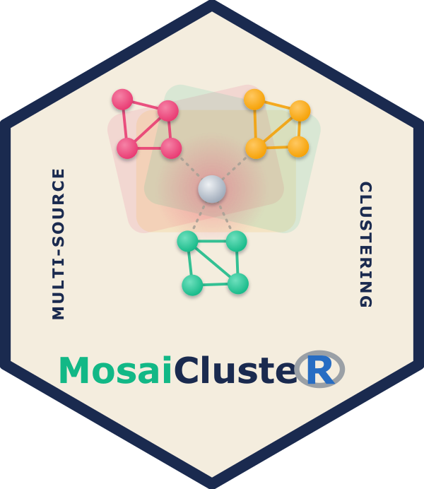

``` R
<h1>MosaiClusteR</h1>
<p>An umbrella framework for multi-source and multi-omics clustering in R. One interface, many methods, and a complete workflow, from raw modalities to interpretable subgroups.</p>
<p class="mc-cta">
  <a class="mc-btn mc-btn-primary" href="articles/MosaiClusteR.html">Get started</a>
  <a class="mc-btn" href="articles/method-comparison.html">Compare methods</a>
  <a class="mc-btn" href="reference/index.html">Reference</a>
  <a class="mc-btn" href="https://github.com/lucp12891/MosaiClusteR">GitHub</a>
</p>
```

## Why MosaiClusteR

Multi-omics and other multi-source studies measure the same objects
through several heterogeneous lenses, and no single modality tells the
whole story. The many integration algorithms in the literature live in
scattered packages with incompatible inputs. MosaiClusteR gathers them
behind **one list-of-matrices interface** (objects in rows, features in
columns) with **one return contract** (`DistM`, `Clust`), so methods are
directly comparable and the evaluation and visualisation tools work with
any of them.

### Direct

Concatenate the sources and cluster once. `ADC`, `ADEC`.

### Similarity-based

Fuse per-source object similarities. `SNF`, `WeightedClust`, `WonM`,
`NEMO`.

### Graph-based

Partition a graph built from many clusterings. `EnsembleClustering`,
`HBGF`.

### Voting / consensus

Let many partitions vote, including the ABC family. `M_ABC`, `CEC`,
`EvidenceAccumulation`.

### Hierarchy-based

Consense the dendrograms themselves. `HierarchicalEnsembleClustering`,
`EHC`.

### Evaluate and compare

Score with ARI, NMI and Jaccard, and line methods up on the same
footing.

## 60-second quick start

``` r

# install.packages("MosaiClusteR")
library(MosaiClusteR)
data(mosaic_toy)                 # two sources, 60 shared objects, 3 planted groups
L     <- mosaic_toy$List
truth <- mosaic_toy$truth

fit    <- SNF(L, type = "data", distmeasure = c("euclidean", "euclidean"),
              normalize = c(FALSE, FALSE), method = list(NULL, NULL))
labels <- mosaic_labels(fit, k = 3)      # pull a partition from any result
cluster_agreement(labels, truth)         # ARI, NMI, Jaccard, purity
```

The same three lines (integrate, extract, evaluate) work for every
method. See the [method
comparison](https://lucp12891.github.io/MosaiClusteR/articles/method-comparison.md)
to choose one, the [animated
concepts](https://lucp12891.github.io/MosaiClusteR/articles/concepts.md)
for how the paradigms work, and the
[guides](https://lucp12891.github.io/MosaiClusteR/articles/index.md) for
the full workflow.

## The MoSaIC framework


A four-layer pipeline: preprocess, then single-source baselines, then
integration across five paradigms, then evaluation and interpretation.
You can enter at any layer, and every layer speaks the same
`List -> {DistM, Clust}` language.

## Install

``` r

# the stable release, from CRAN
install.packages("MosaiClusteR")

# or the development version
remotes::install_github("lucp12891/MosaiClusteR")
```

MosaiClusteR is released under the GPL-3 licence. Found a bug or have a
request? Open an issue on
[GitHub](https://github.com/lucp12891/MosaiClusteR/issues).
